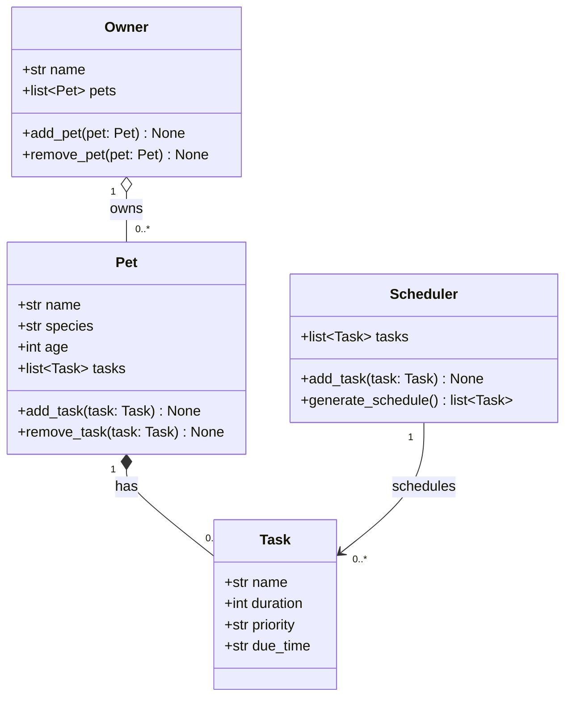

# PawPal+ UML Draft (Phase 1)

## Relationships

- **Owner → Pet (aggregation, 1 to many):** An owner keeps a list of pets and can add or remove them. A pet is its own object and still makes sense apart from any particular owner.
- **Pet → Task (composition, 1 to many):** Each pet has its own care tasks (feeding, walks, meds). A task belongs to a single pet and has no meaning without it.
- **Scheduler → Task (association, 1 to many):** The scheduler gathers tasks and orders them into a daily plan with `generate_schedule()`. It points to tasks but does not own them; they still belong to their pets.
