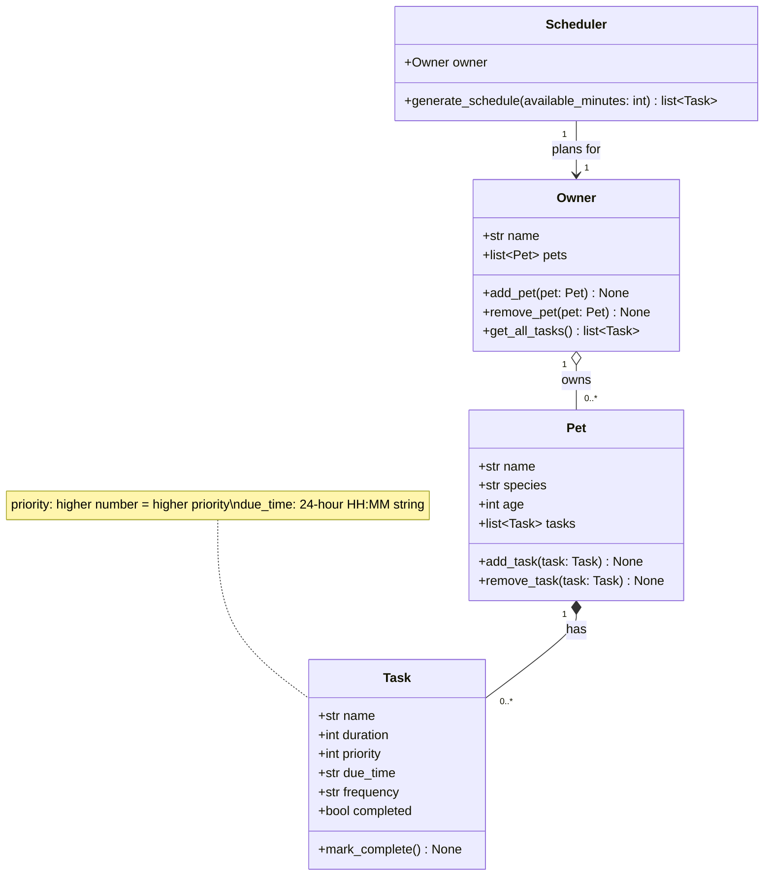

# PawPal+ UML Draft (Phase 1)

## Relationships

- **Owner → Pet (aggregation, 1 to many):** An owner keeps a list of pets and can add or remove them. A pet is its own object and still makes sense apart from any particular owner.
- **Pet → Task (composition, 1 to many):** Each pet has its own care tasks (feeding, walks, meds). A task belongs to a single pet and has no meaning without it.
- **Scheduler → Owner (association, 1 to 1):** The scheduler holds a reference to an owner and reads tasks through `owner.get_all_tasks()` (which collects them from `owner.pets`) when `generate_schedule(available_minutes)` builds the daily plan. It keeps no task list of its own, so each pet's `tasks` is the single source of truth.
