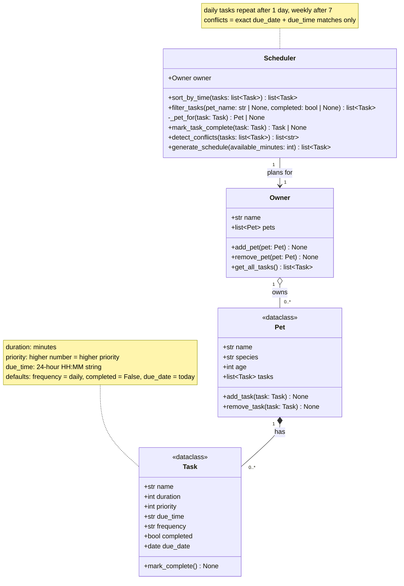

# PawPal+ UML (Final)

This diagram matches the classes in `pawpal_system.py`.

## Relationships

- **Owner → Pet (aggregation, 1 to many):** An owner keeps a list of pets and can add or remove them. A pet is its own object and still makes sense apart from any particular owner.
- **Pet → Task (composition, 1 to many):** Each pet has its own care tasks. A task belongs to a single pet; it doesn't store a reference back to it.
- **Scheduler → Owner (association, 1 to 1):** The scheduler holds a reference to one owner and keeps no task list of its own. Its `filter_tasks()` method retrieves tasks through `Owner.get_all_tasks()`, so each pet's `tasks` list is the single source of truth. When `mark_task_complete()` creates the next occurrence of a recurring task, it uses `_pet_for()` to find the owning pet and adds the new task there.

## Changes since the draft

- **Task:** added `due_date` (defaults to today) so recurring tasks can be scheduled on future days.
- **Scheduler:** added `sort_by_time()`, `filter_tasks()`, `mark_task_complete()`, `detect_conflicts()`, and the private helper `_pet_for()`. `generate_schedule()` now leaves out tasks due on a later date.
- **Annotations:** `Pet` and `Task` are marked `<<dataclass>>`; `Owner` and `Scheduler` are regular classes.
- **Relationships:** unchanged from the draft.
